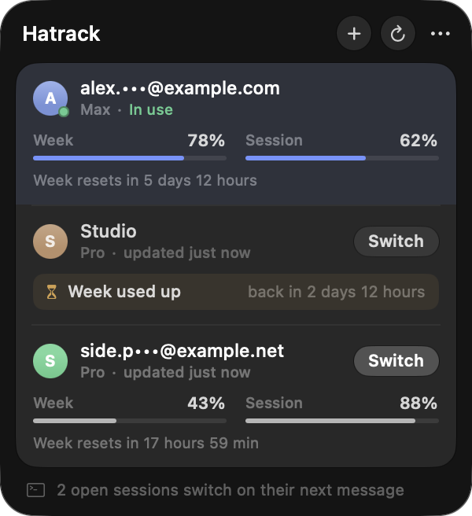

<p align="center">
  
</p>

<h1 align="center">Hatrack</h1>

<p align="center">
  Use several Claude accounts with Claude Code on one Mac.<br>
  See every account's weekly and session usage at a glance, and switch in one click.
</p>

<p align="center">
  
  
  
</p>

<p align="center">
  
</p>

## Features

- **All accounts in one panel.** Weekly and session usage left for every saved account, with
  reset times in plain words ("resets in 5 days 12 hours").
- **One click switch, no restart.** Switching replaces Claude Code's global login. Claude Code
  sessions that are already open move to the new account on their next message.
- **Adding an account never switches.** Sign in through the panel and the account is saved for
  later; whatever you are using right now stays in use.
- **Menu bar at a glance.** Weekly (or session) usage left for the active account, next to the icon.
- **Private by default.** Tokens stay in your macOS Keychain. Emails are partly hidden in the UI.
  No server, no analytics, no network calls except to Anthropic.
- **Liquid Glass** on macOS 26 and later, frosted material on older systems.

## Requirements

| | |
|---|---|
| macOS | 14 Sonoma or later (Liquid Glass on macOS 26+) |
| Build tools | Xcode 26 or its Command Line Tools (Swift 6.2, macOS 26 SDK) |
| Claude Code | Installed and signed in at least once (`claude` on your `PATH` or in `~/.local/bin`) |
| Plan | A Claude subscription (Pro, Max, Team). API key logins have no usage endpoint. |

## Build and install

```sh
git clone https://github.com/joymadhu49/Hatrack.git
cd Hatrack
./Scripts/build.sh --install
```

`build.sh` compiles a universal binary (Apple silicon and Intel) with `swiftc`, signs it, copies it
to `/Applications/Hatrack.app` and launches it. Without `--install` it only builds `build/Hatrack.app`.

Signing: the script uses the first **Developer ID Application** identity in your Keychain, or ad hoc
signing when there is none. Pick one explicitly with:

```sh
HATRACK_SIGNING_IDENTITY="Developer ID Application: Your Name (TEAMID)" ./Scripts/build.sh
```

Hatrack registers itself as a login item the first time it runs. Remove it in
System Settings, General, Login Items.

## Usage

1. Open Hatrack from the menu bar. Your current Claude Code login is picked up automatically.
2. Click **+** and sign in with the browser to add another account. Use a browser profile that is
   signed in to that Claude account (or type its email to pre fill the login page). If the page
   shows a code, paste it into the panel.
3. Click **Switch** on any account. Open sessions use it from their next message.

Right click an account to rename it, reorder it, refresh it or remove it. The **⋯** menu chooses
what the menu bar shows and holds a fallback **Restart idle sessions** command.

> Do not use `/logout` to change accounts. Claude Code revokes the refresh token on logout, and
> the saved copy of that account stops working.

## How it works

Claude Code keeps its login in two places on macOS:

| What | Where |
|---|---|
| OAuth tokens | Keychain item `Claude Code-credentials`, key `claudeAiOauth` |
| Account identity | `~/.claude.json`, key `oauthAccount` |

**Saving accounts.** Hatrack stores each account's `claudeAiOauth` object in its own Keychain
items (service `Hatrack`, one per account) and non secret details such as email, plan and the
last usage numbers in `~/Library/Application Support/Hatrack/accounts.json`.

**Switching.** Hatrack first saves the newest tokens of the current account, refreshes the target
account's token if it is close to expiry, then, under the same lock file Claude Code uses
(`~/.claude/.storage-write.lock`), replaces only `claudeAiOauth` in the live Keychain item. Other
entries such as MCP server logins are kept. Finally it updates `oauthAccount` in `~/.claude.json`.

**No restart.** Before every request, a running Claude Code session checks whether the stored
login changed by looking at the modification time of `~/.claude/.credentials.json`. Hatrack bumps
that time after a switch (the file content is not changed), which triggers the same in place login
adoption that happens when you run `/login` in another terminal.

**Adding accounts.** `claude auth login` runs with a private `CLAUDE_CONFIG_DIR`, so the new login
lands in a separate, temporary Keychain item instead of replacing the active one. Hatrack copies
it into its own store and deletes the temporary item and folder.

**Usage.** Numbers come from the same endpoint Claude Code's `/usage` uses
(`api.anthropic.com/api/oauth/usage`). Hatrack never refreshes the token of the active account,
because Claude Code owns it; inactive accounts are refreshed by Hatrack and the rotated tokens are
saved immediately.

**Keychain access** goes through `/usr/bin/security`, the same tool Claude Code uses, so macOS does
not ask for your password.

## Command line

The app binary has a few flags that are handy for checking things without opening the UI:

```sh
APP=/Applications/Hatrack.app/Contents/MacOS/Hatrack
$APP -list                         # accounts and usage as JSON (no tokens)
$APP -window shot.png -demo        # render the panel with made up accounts
$APP -icon icon.png                # render the menu bar mark
```

## Project layout

```
Sources/
  main.swift          app entry, status item, command line modes
  Store.swift         accounts, capture, switching, sign in, usage polling
  Keychain.swift      Keychain access via /usr/bin/security
  ClaudeConfig.swift  ~/.claude.json, Claude Code's write lock, session nudge
  API.swift           usage, profile and token refresh endpoints
  Sessions.swift      running sessions, isolated `claude auth login`
  Views.swift         the panel
  Glass.swift         Liquid Glass helpers with fallbacks
  BarIcon.swift       menu bar mark
Scripts/
  build.sh            build, sign, install
  make-icon.swift     renders Resources/AppIcon.icns
```

## Caveats

- Hatrack relies on how Claude Code stores its login and on an undocumented usage endpoint.
  A Claude Code update can change either. It was built against Claude Code 2.1.318.
- Only Claude Code is switched. The Claude desktop app and claude.ai have their own sign in.
- `CLAUDE_CODE_OAUTH_TOKEN` in your environment overrides the Keychain login in Claude Code;
  unset it if switching seems to have no effect.
- Make sure using several accounts fits the terms of your Claude plan.

## Uninstall

```sh
pkill -x Hatrack; rm -rf /Applications/Hatrack.app
rm -rf ~/Library/Application\ Support/Hatrack
# saved tokens, one item per account:
security delete-generic-password -s Hatrack   # repeat until it reports no item
```

## License

[MIT](LICENSE)

Hatrack is an independent project and is not affiliated with or endorsed by Anthropic.
Claude and Claude Code are trademarks of Anthropic.
